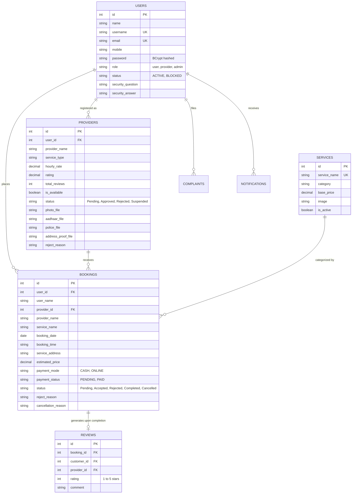

# UrbanTasker - Full-Stack Service Booking Platform

[](https://urbantasker.onrender.com)
[](https://github.com/akhileshchaubey51/urbantasker)
[](https://spring.io/projects/spring-boot)
[](https://sqlite.org/)

> **🌐 Live Hosted Website:** [https://urbantasker.onrender.com](https://urbantasker.onrender.com)  
> **Tagline:** Find Trusted Professionals. Book Services. Live Better.

UrbanTasker is a comprehensive, production-grade service-booking marketplace web platform developed for college PBL submission. It bridges the gap between verified local service professionals and homeowners seeking dependable on-demand services (electricians, plumbers, home cleaning, AC repair, carpentry, painting, appliance repair, and salon services).

---

### 🚀 Live Demo Quick Links
- **Public Homepage & Services:** [https://urbantasker.onrender.com](https://urbantasker.onrender.com)
- **Customer Dashboard:** [https://urbantasker.onrender.com/dashboard.html](https://urbantasker.onrender.com/dashboard.html) (`khushi@example.com` / `password123`)
- **Provider Dashboard:** [https://urbantasker.onrender.com/provider-requests.html](https://urbantasker.onrender.com/provider-requests.html) (`divyansh@example.com` / `password123`)
- **Admin Panel:** [https://urbantasker.onrender.com/admin.html](https://urbantasker.onrender.com/admin.html) (`admin@gmail.com` / `admin123`)
- **Provider Verification Onboarding:** [https://urbantasker.onrender.com/provider.html](https://urbantasker.onrender.com/provider.html)

---

## 1. PBL Team Structure & File Allocation

This project strictly adheres to the team module split and file ownership rules established for the group project:

| Member | Assigned Controller | Assigned Templates / Views | Core Functional Responsibilities |
| :--- | :--- | :--- | :--- |
| **Khushi** | `AuthController.java`<br>`BookingController.java` | `login.html`<br>`register.html`<br>`booking.html` | Authentication, BCrypt registration, Session keys (`userId`, `name`, `role`), Booking placement with initial status `Pending`, Cash + Online payment selection, Booking cancellation, Review submission. |
| **Akansha** | `CustomerController.java` | `dashboard.html`<br>`providers.html`<br>`provider-info.html` | Customer dashboard metrics, Approved provider catalog (`WHERE status='Approved'`), Search & Multi-criteria filters, Provider public profile & customer reviews. |
| **Divyansh** | `ProviderPanelController.java` | `provider-requests.html` | Provider requests dashboard, Session key (`providerId`), Accept requests (`Accepted`), Reject requests with custom reason (`Rejected`), Mark as completed (`Completed`), Availability toggle. |
| **Meghna** | `AdminController.java` | `admin.html`<br>`provider.html`<br>`provider-detail.html` | Provider verification onboarding form, Document review & audit modal (Aadhaar, Police clearance, Address proof), Provider approval/rejection, User moderation, Platform analytics & Chart.js reports, Activity logs. |
| **Shared** | `UrbanTaskerApplication.java`<br>`pom.xml`, `database.sql` | `index.html`<br>`style.css` | Spring Boot main launcher, MySQL relational schema, Global design system (Urban Company + Airbnb aesthetic), Fetch API central engine. |

---

## 2. Technology Stack

- **Backend:** Java 17+, Spring Boot 3.3.x, Spring Web, Spring Data JPA, Spring Security, Hibernate, Jakarta Validation.
- **Database:** SQLite 3 (`urbantasker.db`) – Embedded, portable file-based database. Zero server installation or external database configuration needed!
- **Frontend:** Semantic HTML5, CSS3 Custom Properties (Variables, 3D card tilt, Glassmorphism, Responsive Grid & Flexbox), Vanilla JavaScript (ES6+), Fetch API.
- **Libraries:**
  - **Icons:** Bootstrap Icons / Lucide Icons
  - **Alerts & Modals:** SweetAlert2
  - **Visual Reports:** Chart.js
- **Build Tool:** Apache Maven & Maven Wrapper.

---

## 3. Database Architecture & ER Diagram

The database preserves all original fields from the group's initial SQL schema while augmenting them with robust relational constraints, foreign keys, timestamps, and indexes:



---

## 4. Key PBL Business Rules Implemented

1. **Session Keys (Rule 1):**
   - Every authenticated session stores:
     - `userId`: Numeric identifier
     - `name`: Display name
     - `role`: Exactly `user`, `provider`, or `admin`
     - `providerId`: Numeric identifier from `providers` table (present for providers).
2. **Booking Status Lifecycle (Rule 2):**
   - Exact status keywords used: `Pending`, `Accepted`, `Rejected`, `Completed`, `Cancelled`.
   - Khushi's booking form saves initial booking as `Pending`.
   - Divyansh's provider panel transitions status to `Accepted`, `Rejected` (with reason prompt), or `Completed`.
   - Meghna's admin panel monitors all status updates in real-time.
3. **Approved Providers Filtering (Rule 3):**
   - Akansha's service listing strictly queries with `WHERE status='Approved'`.
   - Unapproved or pending providers are never exposed to customers.
4. **Provider Onboarding Flow (Rule 4):**
   - `User Registers (Khushi)` &rarr; `Submits Document Verification Form (Meghna's provider.html)` &rarr; `Admin Audits and Approves (Meghna's admin.html)` &rarr; `Active Provider Dashboard (Divyansh's provider-requests.html)`.
5. **Payment System (Cash + Online Both):**
   - Customers choose between **Cash After Service** (payment collected upon job completion) or **Instant Online Payment** (simulated checkout with UPI / Card).

---

## 5. REST API Documentation

### Authentication (`/api/auth`) - Owner: Khushi
- `POST /api/auth/register` - Create user/customer/provider account.
- `POST /api/auth/login` - Authenticate with BCrypt validation and initialize session.
- `GET /api/auth/session` - Fetch current active session attributes.
- `POST /api/auth/logout` - Invalidate session.
- `POST /api/auth/reset-password` - Security question verification & password reset.

### Customer & Bookings (`/api/customer`, `/api/bookings`) - Owners: Akansha & Khushi
- `GET /api/customer/dashboard` - Personalized dashboard metrics, bookings, and recommendations.
- `GET /api/customer/providers` - Filter approved providers by category, city, rating, and price.
- `GET /api/customer/providers/{id}` - Public profile with customer ratings and reviews.
- `POST /api/bookings` - Create new booking with status `Pending` (Cash / Online).
- `GET /api/bookings/my` - Fetch booking history for the logged-in customer.
- `PUT /api/bookings/{id}/cancel` - Cancel booking before completion.
- `POST /api/bookings/review` - Submit 1-5 star review for completed booking.

### Provider Panel (`/api/provider`) - Owner: Divyansh
- `GET /api/provider/dashboard` - Metrics for requests, earnings, and availability.
- `GET /api/provider/requests` - Real-time incoming customer booking requests.
- `PUT /api/provider/requests/{id}/accept` - Accept incoming request.
- `PUT /api/provider/requests/{id}/reject` - Reject request with mandatory reason.
- `PUT /api/provider/requests/{id}/complete` - Mark booking completed and record earnings.
- `PUT /api/provider/toggle-availability` - Toggle active accepting state.

### Administration Console (`/api/admin`) - Owner: Meghna
- `GET /api/admin/dashboard` - Platform metrics and Chart.js trend dataset.
- `GET /api/admin/providers/pending` - Pending provider applications.
- `GET /api/admin/providers/{id}` - Review applicant documents and credentials.
- `PUT /api/admin/providers/{id}/approve` - Grant approval and publish provider.
- `PUT /api/admin/providers/{id}/reject` - Reject provider with feedback.
- `GET /api/admin/users` - Platform user directory.
- `PUT /api/admin/users/{id}/toggle-block` - Block or restore account access.
- `POST /api/admin/provider-verification` - Multipart document upload endpoint.
- `GET /api/admin/complaints` & `PUT /api/admin/complaints/{id}/resolve` - Handle support complaints.

---

## 6. How to Set Up and Run Locally

### Prerequisites
- Java JDK 17 or higher (`java -version`)
- **Zero Database Setup:** Uses self-contained embedded SQLite (`urbantasker.db`). No external MySQL server or credentials are required!

### Step 1: Run the Application Directly
Open a terminal / PowerShell inside `C:\Users\hp\.gemini\antigravity\scratch\urbantasker`:
```powershell
# Using Maven Wrapper (Windows)
.\mvnw.cmd spring-boot:run

# Or if you have Maven installed:
mvn spring-boot:run
```

Alternatively, open the project in **IntelliJ IDEA**, **Eclipse**, or **VS Code** and run `UrbanTaskerApplication.java`.

### Step 2: Automatic Database Initialization
Upon the very first launch, `DatabaseInitializer.java` will automatically:
1. Create `urbantasker.db` in the project root.
2. Seed the Admin account (`admin@gmail.com` / `admin123`).
3. Seed 8 core service categories (Electrician, Plumber, Cleaning, AC, etc.).
4. Seed verified providers (`divyansh@example.com`, `rajesh@example.com`, `suresh@example.com`, `pooja@example.com`).
5. Seed a pending provider (`vikram@example.com`) for the admin document verification test.
6. Seed working customer bookings and reviews.

### Step 3: Open in Web Browser
Navigate to:
```
http://localhost:8080/
```

---

## 7. Default Seed Credentials (For Viva / Demo Testing)

| Role | Username / Email | Password | Access Highlights |
| :--- | :--- | :--- | :--- |
| **Super Admin** | `admin@gmail.com` | `admin123` | Document verification modal, approve/reject providers, block accounts, platform charts. |
| **Customer** | `khushi@example.com` | `password123` | Service booking, cash/online selection, booking cancellation, review submission. |
| **Provider** | `divyansh@example.com` | `password123` | Incoming request cards, accept/reject with reason, mark completed, earnings overview. |
| **Pending Provider** | `vikram@example.com` | `password123` | Seed pending applicant waiting in Admin queue for verification test. |

---

## 8. Verification Flow Demonstration Guide

1. Log in as **Customer** (`khushi@example.com` / `password123`).
2. Search for `Electrician` or `AC Repair`. Click **Book Now** on an approved provider.
3. Choose preferred date/time slot, enter address, select **Online Payment** or **Cash After Service**, and confirm booking.
4. Log out and log in as **Provider** (`divyansh@example.com` / `password123`).
5. Open the **Incoming Requests** panel. See the newly placed request with status `Pending`.
6. Click **Accept Request** (status updates to `Accepted`).
7. Click **Mark as Completed** (status updates to `Completed`, earnings increase, payment status changes to `PAID`).
8. Return to **Customer Dashboard**. You will see the service marked completed with an enabled **Rate & Review** button.
9. Log in as **Admin** (`admin@gmail.com` / `admin123`) to review applicant `Vikram Rathore` under **Provider Verification Applications**, audit his documents, and approve him.
